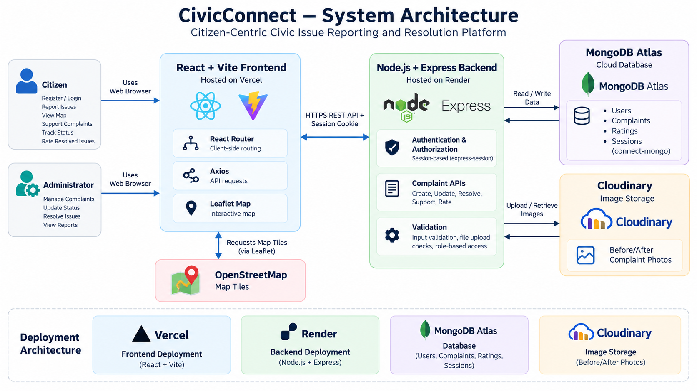
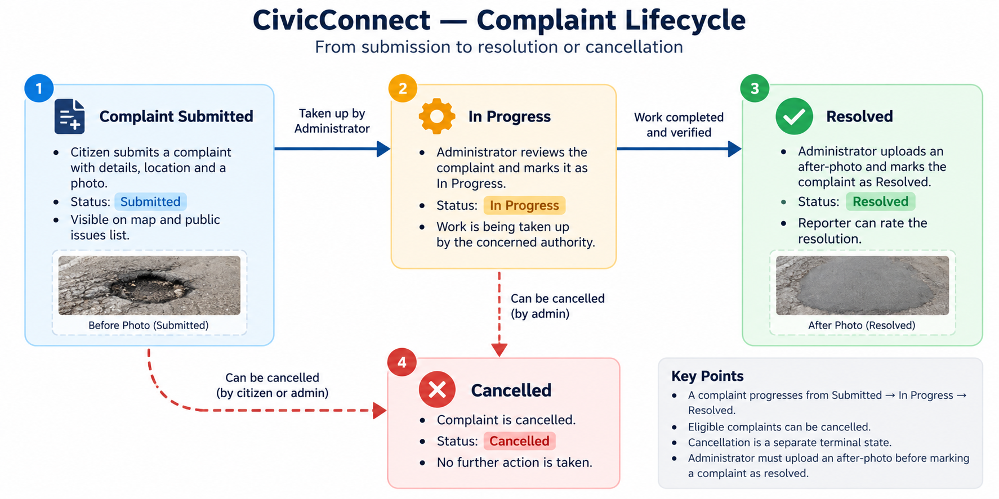

# CivicConnect — Technical Design Document

## 1. Overview

CivicConnect is a web-based civic issue reporting and resolution platform designed to help citizens report local infrastructure and public-service problems. Citizens can submit complaints with photographs and precise locations, discover nearby issues, and support complaints affecting their communities. Administrators can manage complaints and document their resolution.

**Live Demo:** https://civic-connect-vert-pi.vercel.app

**Repository:** https://github.com/Kailash-Rooj/civic-connect

## 2. Technology Stack

| Layer | Technology |
|---|---|
| Frontend | React, Vite, Tailwind CSS |
| Routing | React Router |
| HTTP client | Axios |
| Maps | Leaflet, React Leaflet, OpenStreetMap |
| Backend | Node.js, Express.js |
| Database | MongoDB Atlas, Mongoose |
| Authentication | express-session, connect-mongo, bcrypt |
| Image storage | Cloudinary |
| Frontend hosting | Vercel |
| Backend hosting | Render |

## 3. System Architecture

## 4. User Roles

### Citizen
- Register and log in.
- Submit complaints with a description, category, photograph, and location.
- View public complaints and their locations on a map.
- Support complaints affecting them.
- Track their own complaints.
- Cancel eligible complaints.
- Rate resolved complaints they originally reported.

### Administrator
- View and manage complaints.
- Move submitted complaints into progress.
- Cancel eligible complaints.
- Resolve complaints by uploading an after-photo.
- Review complaint information and existing feedback.

Administrator accounts are created privately rather than through public citizen registration.

## 5. Complaint Lifecycle

## 6. Duplicate Detection and Community Support

Before accepting a new complaint, the backend checks for an existing unresolved complaint of the same category within that category's configured geographic radius.

This helps reduce duplicate reports of the same issue. Resolved and cancelled complaints do not block new reports.

Citizens can support an existing complaint if they are also affected. Each citizen can support a complaint only once, and the original reporter cannot support their own complaint.

## 7. Authentication and Session Management

The application uses server-side sessions rather than storing authentication tokens in browser local storage.

- Passwords are hashed using bcrypt.
- Sessions are stored in MongoDB through connect-mongo.
- Session cookies are configured as HTTP-only.
- Production cookie settings support cross-origin frontend and backend deployment.

The backend must verify authentication and role permissions before allowing protected operations.

## 8. Data Storage

MongoDB stores user accounts, complaint records, complaint status, geographic coordinates, affected-citizen information, and ratings.

Cloudinary stores uploaded complaint images. The database stores the corresponding image URLs or references.

Sensitive configuration values, including database credentials and session secrets, must be supplied through environment variables and must not be committed to Git.

## 9. Deployment Architecture

- **Frontend:** Vercel
- **Backend API:** Render
- **Database:** MongoDB Atlas
- **Image hosting:** Cloudinary

The deployed frontend communicates with the backend through HTTP API requests. The backend connects to MongoDB Atlas and Cloudinary using server-side configuration.

## 10. Security Considerations

The application should enforce server-side input validation, role-based authorization, complaint ownership checks, upload size and file-type restrictions, secure session configuration, and rate limiting for sensitive endpoints.

Database credentials, API secrets, and session secrets must remain private. Dependency audits and authorization tests should be performed before public demonstrations.

## 11. Testing Strategy

The following scenarios should be tested before release:

1. Citizen registration and login.
2. Rejection of invalid credentials and malformed input.
3. Complaint submission with a valid photograph and location.
4. Duplicate complaint detection.
5. Prevention of repeated support by the same citizen.
6. Prevention of unauthorized complaint modification.
7. Correct enforcement of citizen and administrator permissions.
8. Complaint cancellation and status transitions.
9. Resolution requiring an after-photo.
10. Rating permissions and rating updates.
11. Map loading and complaint navigation.
12. Image upload limits and unsupported file rejection.

Test results should be recorded separately as the tests are executed.

## 12. Future Improvements

Potential future improvements include expanded multilingual support, complaint heatmaps, administrative analytics, automated security testing, and citizen verification of completed resolutions.

---

**Document status:** Technical design for the CivicConnect prototype. Implementation details and test results should be verified against the current source code and deployed application.